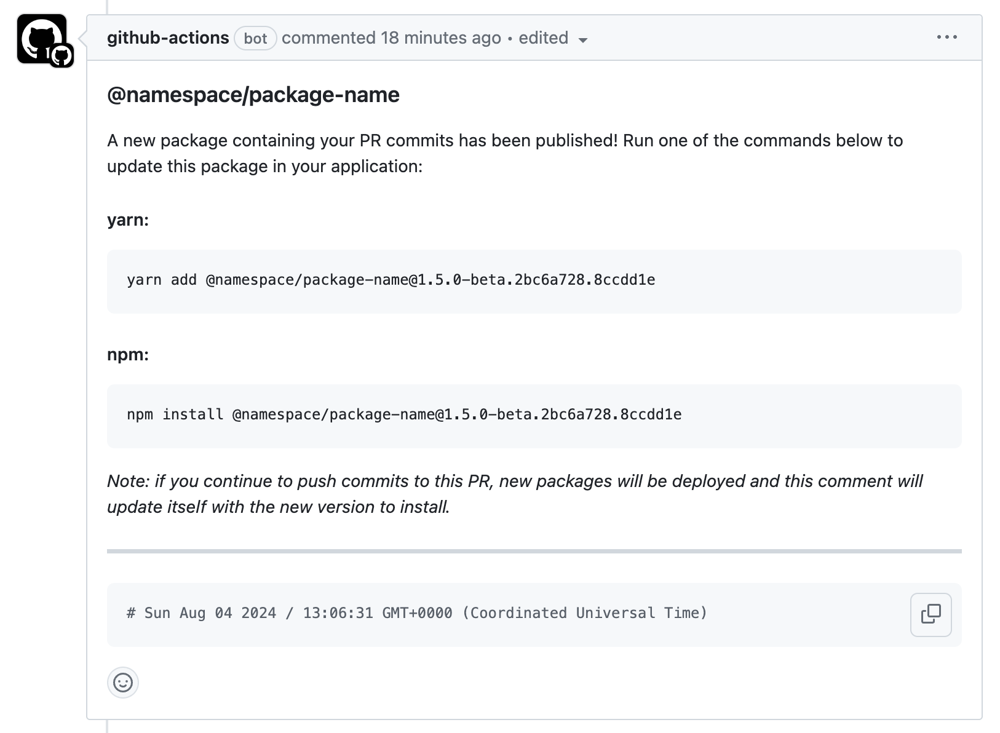
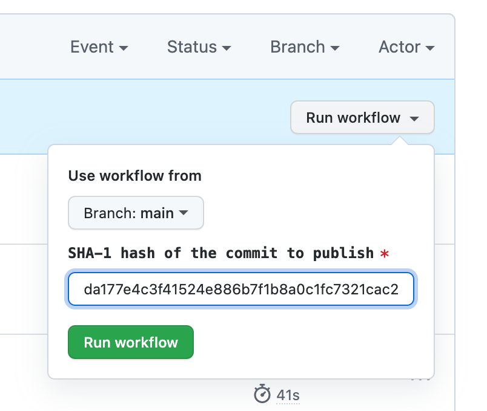
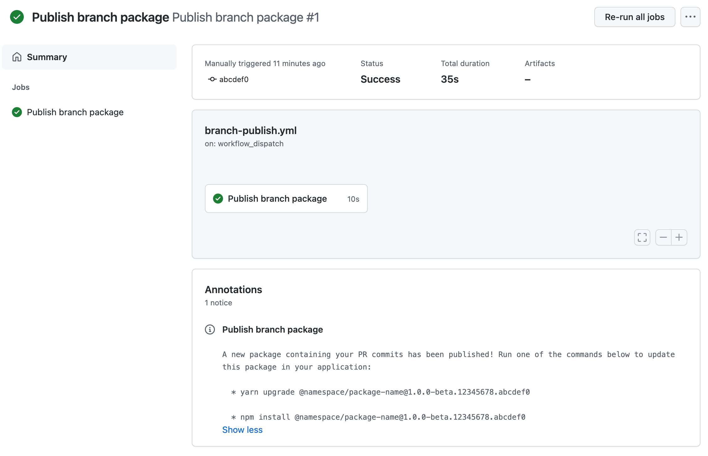

# publish-branch-to-npm

GitHub action to publish a pre-release version of an npm package to the registry.

The action publishes with [npm trusted publishing](https://docs.npmjs.com/trusted-publishers). It does not use an npm token.

## Setup

Do these steps once for each repository and package.

1. Give the job (or the whole workflow) that runs this action these permissions:

   ```yml
   permissions:
     contents: read # check out the repository
     pull-requests: write # pull_request trigger only: post the installation comment
     id-token: write # npm trusted publishing
   ```

   A `permissions` block sets every permission it does not name to `none`. Keep any other permission that the job already needs.

2. On npmjs.com, add a trusted publisher to each package. See [the npm docs](https://docs.npmjs.com/trusted-publishers#for-github-actions).
   - Publisher: GitHub Actions.
   - Owner and repository: the repository that runs this action.
   - Workflow filename: the file that runs this action, for example `publish-branch-package.yml`. Give only the filename, not the path.
   - Allowed actions: allow `npm publish`. This action uses `npm publish`. Configurations created after September 3, 2026 allow only `npm stage publish` by default.

   The package must publish successfully within 2 days, or the new configuration expires.

3. Run the job on a GitHub-hosted runner with npm 11.5.1 or later and Node 22.14.0 or later.
   - The action runs the npm on the `PATH`, usually from `actions/setup-node`. It does not bring its own npm.
   - Node 24.5.0 and later include npm 11.5.1 or later. Node 22 includes npm 10, so run `npm install --global npm@^11.5.1` before this action.
4. Make `repository.url` in the `package.json` of the package match the GitHub repository exactly.
5. Do not set an npm token for the job or the workflow, for example `NODE_AUTH_TOKEN`. If trusted publishing fails, npm uses a token that it finds instead. If a step that installs private dependencies needs a token, set it in the `env` of that step only.

If the job does not have the `id-token: write` permission, the action fails before it runs npm. A dry run skips this check.

If a publish fails, look for lines that contain `oidc` in the job log. The action runs `npm publish --verbose`, so npm logs why trusted publishing failed. No `oidc` lines at all usually means that the npm on the `PATH` is too old (see step 3).

### Upgrading from v2

1. In one change, set `uses:` to `wistia/publish-branch-to-npm@v3.0.0` (or its commit SHA), delete the `npm_token` line, and make the repository edits in [Setup](#setup) steps 1, 3, 4 and 5. v2 fails without `npm_token`.
2. Add the trusted publisher on npmjs.com (Setup step 2) only when the change is ready.
3. Publish a branch package within 2 days of adding the trusted publisher. Open a pull request, or run the workflow by hand from the branch with the change ("Use workflow from").
4. After a branch package publishes, delete the npm token secret if nothing else uses it.

A bot pull request that only changes the version in `uses:` fails at the `id-token: write` check until you finish Setup.

## Inputs

### github_token

A token that GitHub automatically creates and stores in a `GITHUB_TOKEN` secret to use in your workflow.

### dry_run

Does everything publish would do except actually publishing to the registry. Reports the details of what would have been published, see [npm publish docs](https://docs.npmjs.com/cli/v7/commands/npm-publish). `dry_run` is optional and defaults to `false`.

### commit_hash

The SHA-1 hash of the commit to publish; this is set automatically and does not need to be provided, unless `workflow_dispatch` trigger is used (see below).

### workspace

The name of the workspace to publish in a monorepo (ie. `@organization/workspace`). `workspace` is optional.

When `workspace` is set, the action runs `npm version` with `--workspaces-update=false`, so npm does not install dependencies after it updates the version. Install dependencies and build the package in an earlier step.

## Usage

This action can be triggered by **`pull_request`** and **`workflow_dispatch`** event triggers:

### pull_request

Add the following step to your workflow job (after repo checkout, node setup, etc). The job needs the permissions in [Setup](#setup).

```yml
- name: Publish branch package to npm
  uses: wistia/publish-branch-to-npm@v3.0.0
  with:
    github_token: ${{ secrets.GITHUB_TOKEN }}
```

`github_token` is a required input and this action cannot work without it.

When the action completes, you should see a comment like this in new Pull Requests:



If new commits are pushed to to a pre-existing branch, the comment will update itself with the new version instructions.

### workflow_dispatch

This action can also be triggered manually. The job needs the permissions in [Setup](#setup).

```yml
on:
  workflow_dispatch:
    inputs:
      commit_hash:
        description: 'SHA-1 hash of the commit to publish'
        required: true
---
- name: Publish branch package to npm
  uses: wistia/publish-branch-to-npm@v3.0.0
  with:
    github_token: ${{ secrets.GITHUB_TOKEN }}
    commit_hash: ${{ github.event.inputs.commit_hash }}
```

Now if you visit the `Actions` tab in GitHub, and click on your workflow, there should now be a `Run workflow` button:



As opposed to the `pull_request` event trigger which can derrive `commit_hash`, here it must be provided. The commit used does not need to be merged to the default branch (ie. `main`) but it does need to be present in a branch accessible to GitHub.

When the action completes, you should see an annotation that looks like this:



## Development

### Releasing new versions to GitHub Marketplace

It's easiest to just use `npm` to manage the versioning:

1. `npm version [major, minor, patch]`_\*_ (_note: this will update the version field in `package.json`, create a tag with the new version number, run a build & commit those changes_)
2. `git push origin head --tags`
3. visit the [release](https://github.com/wistia/publish-branch-to-npm/releases) page, click `Draft new release` and fill out form

Read more about [publishing actions in GitHub Marketplace](https://docs.github.com/en/actions/creating-actions/publishing-actions-in-github-marketplace).
